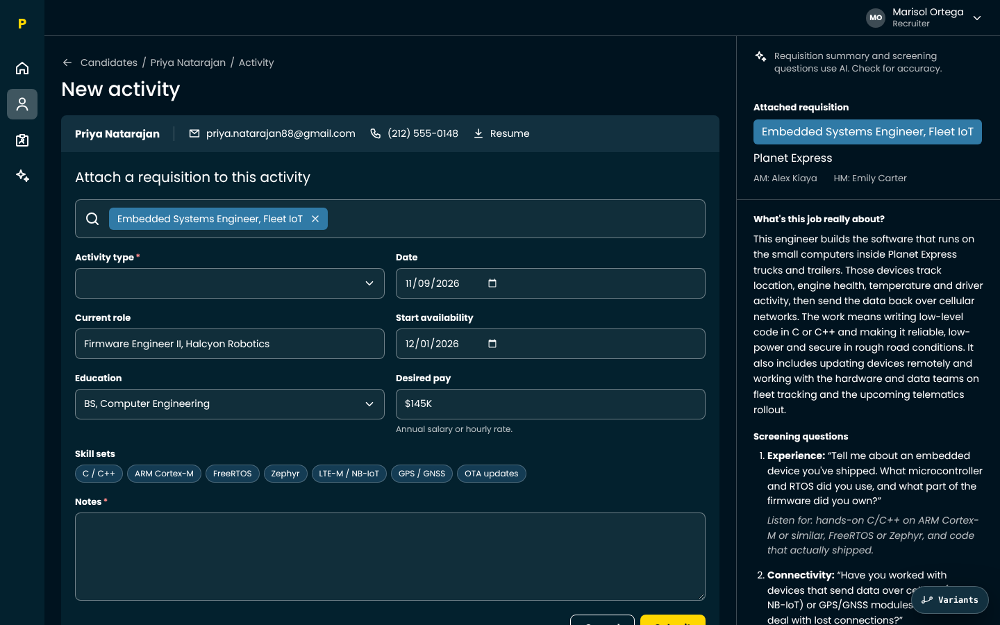

# Otto

A design-system-driven starting point for **deployable, high-fidelity product prototypes**. Instead of rebuilding navigation, components, theming and hosting for every idea, start from a template that already has them, and spend your time on the product question.

**[Live demo](https://YOUR-USERNAME.github.io/otto/)** · [Guidelines](Guidelines.md) · [Component docs](docs/README.md) · [Branching](BRANCHING.md) · [Roles](ROLES_AND_PERMISSIONS.md) · [Case study](docs/case-study.md)



## What's inside

* **The Otto design system** — tokens for every color, type style, space and radius; ~25 accessible React components; a living showcase (Foundations, Components, Patterns and Layouts).
* **Two component layers** — design-system components for pages, primitives (portal, focus trap, positioning, icons) used only inside them.
* **Codified standards** — [Guidelines.md](Guidelines.md) covers typography, tokens, layout, forms, menus, chips, buttons, states, copy and action labels, so output stays consistent whoever builds it.
* **UX branching** — build several variants of a feature, switch live in the browser, share an exact variant with `?branch=<id>`, and track each one as Exploration, Candidate or Final. See [BRANCHING.md](BRANCHING.md).
* **Roles and permissions** — five roles and one permission table drive navigation, page access and actions. See [ROLES_AND_PERMISSIONS.md](ROLES_AND_PERMISSIONS.md).
* **A sample recruiting app** — candidates, a candidate profile, a **New activity** flow that attaches a requisition and shows an AI job summary and screening questions, requisitions with a side sheet, accounts, reports and settings.
* **Deploy anywhere** — GitHub Pages workflow included, plus a Dockerfile for container hosting.

## Stack

React 18 · TypeScript · Vite · Tailwind CSS v4 (layout utilities mapped to Otto tokens) · React Router · no UI library dependencies.

## Start a new prototype

```bash
# 1. Use this repo as a template on GitHub (or clone it)
git clone https://github.com/YOUR-USERNAME/otto.git my-prototype
cd my-prototype

# 2. Name it
npm install
npm run init-app      # asks for the app name, description and owner, then updates package.json, README, index.html and catalog-info.yaml

# 3. Run it
npm run dev
```

Then replace `src/data/sample.ts` with your scenario's data and start building pages in `src/app/pages/` from the components in `src/components/ds/`.

## Scripts

| Command | What it does |
| --- | --- |
| `npm run dev` | Local dev server with hot reload |
| `npm run build` | Type-check and build to `dist/` |
| `npm run preview` | Serve the production build locally |
| `npm run typecheck` | Type-check only |
| `npm run init-app` | Rename the template for a new prototype |

## Project structure

```
src/
  styles/
    theme.css               Tailwind v4 + token mapping (imports the design system)
    template-extras.css     template-only additions on top of the design system
design-system/              the Otto design system, source of truth for styling
  css/tokens.css            design tokens (the only place colors and sizes are defined)
  css/components.css        component styles, all prefixed otto-
  docs/                     component usage and styling docs
  examples/  dist/          example pages and the embeddable build
  site/  scripts/serve.py   local showcase, playground and audit tool (see design-system/README.md)
  components/
    ds/                     design-system components (use these in pages)
    primitives/             internal building blocks + icon set
  branching/                UX branching registry, context and Variants panel
  roles/                    roles, permissions, <Can>, useRole()
  app/
    layout/RootLayout.tsx   providers, side nav, top bar, account menu
    routes.tsx              all routes
    pages/                  sample app + design-system showcase
  data/sample.ts            made-up sample data
docs/
  components/               usage guidelines per component
  styling/                  styling and implementation per component
  case-study.md             portfolio write-up
```

## Deploy

**GitHub Pages:** push to `main`. `.github/workflows/deploy.yml` builds with the right base path and publishes. In the repo settings, set Pages → Source to **GitHub Actions** once.

**Container:**

```bash
docker build -t my-prototype .
docker run -p 8080:80 my-prototype
```

`catalog-info.yaml` is included for teams that register services in a [Backstage](https://backstage.io) catalog; delete it if you don't.

## Accessibility

Native elements first; every interactive component works with a keyboard; focus is always visible; color is never the only signal; text meets WCAG AA on every surface. Menus, tabs, autocomplete, dialogs and side sheets follow the WAI-ARIA Authoring Practices patterns.

## Credits

Designed and built by **Mick Bailey**. All people, companies and contact details in the sample data are made up.

## License

[MIT](LICENSE)
